# 🗄️ Лабораторная работа №4 — Основы SQL. Работа с SQLite

<div align="center">

### **Введение в Backend-разработку**

**Выполнил:** Мамиев Ибрагим Ахмедович

**Группа:** `ПИЖ-б-о-25-2(2)`

**Направление подготовки:** `09.03.04 — Программная инженерия`

**Вариант:** №6

**Уровень выполнения:** Продвинутый

</div>

---

## 📌 Цель работы

Изучить основы языка структурированных запросов SQL и получить практические навыки работы с реляционными базами данных на примере SQLite.

В ходе лабораторной работы необходимо освоить создание таблиц и управление их структурой, выполнение CRUD-операций, фильтрацию и сортировку записей, использование агрегатных функций, группировку данных, объединение таблиц, подзапросы и транзакции.

Дополнительно требуется реализовать связь между таблицами с помощью внешнего ключа, создать индексы и подготовить отдельный SQL-скрипт для инициализации структуры базы данных.

---

## 🛠️ Используемые технологии и инструменты

| Технология / инструмент | Назначение |
|---|---|
| **Node.js** | Среда выполнения JavaScript |
| **JavaScript** | Язык программирования |
| **SQLite** | Реляционная база данных |
| **better-sqlite3** | Библиотека для работы с SQLite из Node.js |
| **SQL** | Язык запросов к базе данных |
| **npm** | Управление зависимостями и командами проекта |
| **Nodemon** | Автоматический перезапуск приложения |
| **DB Browser for SQLite** | Просмотр структуры базы данных и выполнение SQL-запросов |
| **Visual Studio Code** | Редактор кода |
| **Git / GitHub** | Контроль версий и хранение проекта |

---

## 📖 Теоретические сведения

### 1. SQL и реляционные базы данных

**SQL (Structured Query Language)** — язык структурированных запросов, предназначенный для создания, изменения и управления данными в реляционных базах данных.

Реляционная база данных хранит информацию в виде таблиц, состоящих из строк и столбцов. Каждая строка представляет отдельную запись, а столбцы определяют характеристики этой записи.

В рамках работы используется SQLite — компактная реляционная СУБД, которая хранит базу данных в одном файле и не требует запуска отдельного сервера.

### 2. Основные группы SQL-команд

SQL-команды условно разделяются на несколько категорий:

| Категория | Назначение | Примеры |
|---|---|---|
| **DDL** | Определение структуры базы данных | `CREATE`, `ALTER`, `DROP` |
| **DML** | Добавление и изменение данных | `INSERT`, `UPDATE`, `DELETE` |
| **DQL** | Получение данных | `SELECT` |
| **TCL** | Управление транзакциями | `BEGIN`, `COMMIT`, `ROLLBACK` |

DDL используется для создания и изменения таблиц, DML — для управления записями, DQL — для получения информации, а TCL — для управления группами операций.

### 3. CRUD-операции

CRUD — набор четырёх основных операций, применяемых при работе с данными:

| Операция | Назначение | SQL-команда |
|---|---|---|
| **Create** | Создание записи | `INSERT` |
| **Read** | Чтение данных | `SELECT` |
| **Update** | Изменение записи | `UPDATE` |
| **Delete** | Удаление записи | `DELETE` |

CRUD является основой большинства приложений, работающих с базами данных.

### 4. Связи между таблицами

Для организации связей между таблицами используются первичные и внешние ключи.

**PRIMARY KEY** — поле или набор полей, однозначно определяющих запись в таблице.

**FOREIGN KEY** — поле, которое ссылается на первичный или уникальный ключ другой таблицы и обеспечивает ссылочную целостность данных.

В данной работе используется связь типа «один ко многим»: одна учебная группа может содержать несколько студентов, но каждый студент относится к одной группе.

### 5. Агрегатные функции и группировка

Агрегатные функции позволяют выполнять вычисления над набором записей.

В SQL используются следующие функции:

- `COUNT()` — подсчёт количества записей;
- `SUM()` — вычисление суммы;
- `AVG()` — вычисление среднего значения;
- `MAX()` — поиск максимального значения;
- `MIN()` — поиск минимального значения.

Для объединения записей в группы применяется `GROUP BY`, а для фильтрации уже сформированных групп — `HAVING`.

### 6. JOIN, подзапросы и транзакции

`JOIN` используется для объединения данных из нескольких таблиц.

Основные типы объединения:

- `INNER JOIN` — возвращает записи, для которых найдено соответствие в обеих таблицах;
- `LEFT JOIN` — возвращает все записи из левой таблицы и соответствующие записи из правой. Если соответствия нет, поля правой таблицы принимают значение `NULL`.

**Подзапрос** — SQL-запрос, вложенный в другой запрос. Он позволяет использовать результат одного запроса при выполнении другого.

**Транзакция** — последовательность операций с базой данных, которая рассматривается как единое целое.

Основные команды управления транзакциями:

- `BEGIN` — начало транзакции;
- `COMMIT` — подтверждение изменений;
- `ROLLBACK` — отмена изменений.

### 7. Индексы

**Индекс** — дополнительная структура базы данных, предназначенная для ускорения поиска и фильтрации записей.

Индексы особенно полезны при выполнении запросов с условиями `WHERE`, однако они занимают дополнительное место и могут увеличивать стоимость операций изменения данных.

---

## 🎯 Индивидуальное задание

**Вариант №6 — Продвинутый уровень.**

В качестве предметной области выбрана система учёта студентов и учебных групп.

В рамках задания необходимо:

1. Создать таблицу студентов с полями `id`, `name`, `group_id`, `avg_grade`.
2. Создать отдельную таблицу учебных групп.
3. Реализовать связь один-ко-многим с использованием `FOREIGN KEY`.
4. Выполнить основные CRUD-операции.
5. Реализовать сортировку, фильтрацию и пагинацию.
6. Использовать агрегатные функции.
7. Выполнить группировку данных с помощью `GROUP BY` и фильтрацию групп через `HAVING`.
8. Реализовать объединение таблиц с помощью `INNER JOIN` и `LEFT JOIN`.
9. Выполнить запрос с использованием подзапроса.
10. Продемонстрировать работу транзакций с `COMMIT` и `ROLLBACK`.
11. Создать индексы и проверить их наличие.
12. Подготовить отдельный SQL-файл `init_db.sql` для инициализации структуры базы данных.

---

## 🗂️ Структура проекта

```text
lab4-sql-basics/
│
├── 📄 db.js
├── 📄 init_db.sql
├── 📄 package.json
├── 📄 package-lock.json
├── 📄 README.md
├── 📄 execution.log
│
└── 📂 screenshots/
    ├── 01-project-structure.png
    ├── 02-database-creation.png
    ├── 03-insert-data.png
    ├── 04-crud-operations.png
    ├── 05-sorting-pagination.png
    ├── 06-search-filters.png
    ├── 07-aggregate-functions.png
    ├── 08-group-by-having.png
    ├── 09-inner-join.png
    ├── 10-left-join.png
    ├── 11-subquery.png
    ├── 12-transactions.png
    ├── 13-foreign-key.png
    ├── 14-indexes.png
    └── 15-database-structure.png
```

Файл `lab4.db` создаётся автоматически при выполнении программы и не добавляется в Git, поскольку база данных формируется из SQL-скрипта и тестовых данных.

Файл `execution.log` используется для сохранения результатов выполнения программы и также исключён из Git.

### Назначение основных файлов

| Файл | Назначение |
|---|---|
| `db.js` | Основная программа, выполняющая SQL-запросы и демонстрирующая возможности SQLite |
| `init_db.sql` | Скрипт создания таблиц, внешнего ключа и индексов |
| `package.json` | Описание проекта, зависимостей и команд запуска |
| `package-lock.json` | Фиксация версий установленных npm-зависимостей |
| `README.md` | Отчёт и инструкция по выполнению лабораторной работы |
| `lab4.db` | Файл локальной базы данных SQLite |
| `execution.log` | Лог выполнения программы |
| `screenshots/` | Скриншоты, подтверждающие выполнение задания |

---

## ⚙️ Реализация лабораторной работы

### 1. Создание и инициализация базы данных

Для работы с SQLite используется пакет `better-sqlite3`.

Подключение к базе данных осуществляется средствами Node.js:

```js
const Database = require('better-sqlite3');
const path = require('path');

const dbPath = path.join(__dirname, 'lab4.db');
const db = new Database(dbPath);

// Включение проверки внешних ключей
db.pragma('foreign_keys = ON');
```

При первом запуске создаётся файл `lab4.db`. Для подготовки структуры базы данных используется отдельный SQL-скрипт `init_db.sql`.

В нём определяются таблицы, ограничения целостности и индексы.

### 2. Структура базы данных

В проекте реализованы две таблицы: `groups` и `students`.

**Таблица `groups`:**

| Поле | Тип | Назначение |
|---|---|---|
| `id` | INTEGER | Первичный ключ |
| `name` | TEXT | Название учебной группы |

**Таблица `students`:**

| Поле | Тип | Назначение |
|---|---|---|
| `id` | INTEGER | Первичный ключ |
| `name` | TEXT | ФИО студента |
| `group_id` | INTEGER | Внешний ключ на таблицу групп |
| `avg_grade` | REAL | Средний балл студента |

Для поля `avg_grade` установлено ограничение `CHECK`, которое разрешает значения только в диапазоне от 2.0 до 5.0.

Для `students.group_id` настроен внешний ключ, ссылающийся на `groups.id`.

Используется связь **один-ко-многим**:

```text
groups
  |
  | 1
  |
  |------< students
              |
              | group_id
              |
              └── FOREIGN KEY → groups.id
```

### 3. Заполнение таблиц тестовыми данными

После создания структуры база данных заполняется тестовыми записями.

В таблицу `groups` добавлено 7 учебных групп, а в таблицу `students` — 15 студентов.

Одна из групп намеренно оставлена без студентов. Это позволяет продемонстрировать работу `LEFT JOIN`, когда для записи из левой таблицы отсутствует соответствующая запись в правой.

### 4. Выполнение CRUD-операций

Для проверки основных операций с данными реализованы:

- получение полного списка студентов;
- выборка студентов с оценкой выше заданного значения;
- изменение среднего балла студента;
- удаление записи по идентификатору.

Для выполнения операций используются подготовленные SQL-запросы `SELECT`, `INSERT`, `UPDATE` и `DELETE`.

### 5. Сортировка и пагинация

Для сортировки результатов применяются:

- `ORDER BY name ASC` — сортировка студентов по имени;
- `ORDER BY avg_grade DESC` — сортировка по среднему баллу в порядке убывания.

Для реализации пагинации используются `LIMIT` и `OFFSET`.

`LIMIT` задаёт максимальное количество возвращаемых записей, а `OFFSET` определяет количество записей, которые необходимо пропустить.

### 6. Поиск и фильтрация

Для фильтрации данных реализованы запросы с использованием:

- `LIKE` — поиск записей по шаблону;
- `BETWEEN` — выборка значений в заданном диапазоне;
- `IN` — выборка записей, соответствующих одному из нескольких значений.

Это позволяет выполнять поиск студентов по части имени, диапазону оценок и идентификаторам учебных групп.

### 7. Агрегатные функции

Выполнены запросы для получения:

- общего количества студентов;
- суммы всех средних баллов;
- среднего балла;
- максимального среднего балла;
- минимального среднего балла.

Для этого использованы `COUNT()`, `SUM()`, `AVG()`, `MAX()` и `MIN()`.

### 8. Группировка и HAVING

Для анализа успеваемости студентов реализована группировка по учебным группам.

Используется `GROUP BY`, который объединяет записи по идентификатору и названию группы.

Для отбора групп, в которых обучается не менее трёх студентов, применяется условие `HAVING COUNT(students.id) >= 3`.

В результате можно определить количество студентов и средний балл по каждой подходящей группе.

### 9. Объединение таблиц — INNER JOIN

`INNER JOIN` используется для получения информации о студентах вместе с названиями их учебных групп.

Запрос объединяет таблицы `students` и `groups` по полю `group_id`.

В результат попадают только те записи, для которых существует соответствующая учебная группа.

### 10. Объединение таблиц — LEFT JOIN

`LEFT JOIN` возвращает все учебные группы, включая те, в которых пока нет студентов.

Для пустой группы значения полей из таблицы `students` будут равны `NULL`.

Этот запрос позволяет продемонстрировать отличие `LEFT JOIN` от `INNER JOIN`.

### 11. Подзапросы

Для демонстрации вложенных запросов реализована выборка студентов, средний балл которых выше общего среднего балла всех студентов.

Внутренний запрос вычисляет среднее значение с помощью `AVG()`, а внешний использует полученный результат в условии `WHERE`.

### 12. Транзакции

В программе продемонстрированы два сценария работы с транзакциями.

**COMMIT:** выполняются изменения оценок студентов, после чего транзакция подтверждается и изменения сохраняются.

**ROLLBACK:** создаётся временная запись, после чего искусственно вызывается ошибка. Транзакция автоматически отменяется, поэтому тестовая запись не сохраняется в базе данных.

Это позволяет продемонстрировать принцип атомарности транзакций: операции внутри транзакции либо фиксируются вместе, либо отменяются.

### 13. Внешние ключи

Для проверки ссылочной целостности используется внешний ключ `students.group_id`, ссылающийся на `groups.id`.

Дополнительно выполняется попытка добавить студента с несуществующим идентификатором группы.

SQLite отклоняет такую операцию, поскольку она нарушает ограничение внешнего ключа.

### 14. Индексы

Для ускорения поиска созданы два индекса:

- `idx_students_group_id` — индекс по идентификатору учебной группы;
- `idx_students_avg_grade` — индекс по среднему баллу.

Для проверки индексов используется `PRAGMA index_list`, а для анализа плана выполнения запроса — `EXPLAIN QUERY PLAN`.

### 15. Инициализация структуры базы данных

Для создания структуры базы данных подготовлен отдельный файл `init_db.sql`.

В нём содержатся SQL-команды создания таблиц, установки ограничений и создания индексов.

Скрипт выполняется из `db.js` при первичной инициализации базы данных или при полном сбросе с помощью команды `npm run reset`.

Таким образом, структура базы данных отделена от основной логики программы и может быть повторно создана из SQL-файла.

---

## ▶️ Установка и запуск проекта

### 1. Установка зависимостей

Перейти в директорию лабораторной работы:

```bash
cd lab4-sql-basics
```

Установить зависимости:

```bash
npm install
```

### 2. Сброс и повторное создание базы данных

Для удаления прежней структуры, повторного создания таблиц и заполнения базы тестовыми данными используется команда:

```bash
npm run reset
```

### 3. Запуск программы

```bash
npm start
```

### 4. Запуск в режиме разработки

```bash
npm run dev
```

В этом режиме используется Nodemon, который автоматически перезапускает программу при изменении исходных файлов.

### 5. Сохранение результатов выполнения

Для записи вывода программы в отдельный файл используется PowerShell:

```powershell
npm run reset 2>&1 | Tee-Object -FilePath execution.log
```

Файл `execution.log` содержит результаты выполнения программы и сообщения об ошибках, если они возникли.

---

## 🧰 Работа с DB Browser for SQLite

Для дополнительной проверки базы данных используется графическая программа DB Browser for SQLite.

С её помощью можно открыть файл `lab4.db`, просмотреть таблицы, проверить связи, индексы и выполнить SQL-запросы вручную.

Основные команды для проверки:

**Просмотр списка таблиц:**

```sql
SELECT name
FROM sqlite_master
WHERE type = 'table'
ORDER BY name;
```

**Просмотр структуры таблицы:**

```sql
PRAGMA table_info(students);
```

**Просмотр внешних ключей:**

```sql
PRAGMA foreign_key_list(students);
```

**Просмотр индексов:**

```sql
PRAGMA index_list(students);
```

**Проверка внешних ключей:**

```sql
PRAGMA foreign_key_check;
```

**Получение студентов вместе с названиями групп:**

```sql
SELECT
    students.id,
    students.name,
    groups.name AS group_name,
    students.avg_grade
FROM students
INNER JOIN groups
    ON students.group_id = groups.id
ORDER BY students.name;
```

**Группировка студентов по учебным группам:**

```sql
SELECT
    groups.name,
    COUNT(students.id) AS student_count,
    ROUND(AVG(students.avg_grade), 2) AS average_grade
FROM groups
LEFT JOIN students
    ON groups.id = students.group_id
GROUP BY groups.id, groups.name
HAVING COUNT(students.id) >= 3;
```

**Проверка плана выполнения запроса:**

```sql
EXPLAIN QUERY PLAN
SELECT *
FROM students
WHERE group_id = 2;
```

Все запросы выполняются во вкладке **Execute SQL**. Результаты отображаются в нижней части окна программы.

---

## 📸 Результаты выполнения

В ходе выполнения лабораторной работы получены результаты, подтверждающие корректность создания базы данных и выполнения SQL-запросов.

| № | Скриншот | Содержание |
|---:|---|---|
| 1 | `project-structure.png` | Структура проекта и файлы лабораторной работы |
| 2 | `database-creation.png` | Создание и инициализация базы данных |
| 3 | `insert-data.png` | Добавление тестовых групп и студентов |
| 4 | `crud-operations.png` | Выполнение CRUD-операций |
| 5 | `sorting-pagination.png` | Сортировка и пагинация |
| 6 | `search-filters.png` | Поиск и фильтрация данных |
| 7 | `aggregate-functions.png` | Работа агрегатных функций |
| 8 | `group-by-having.png` | Группировка и фильтрация групп |
| 9 | `inner-join.png` | Объединение таблиц с помощью INNER JOIN |
| 10 | `left-join.png` | Объединение таблиц с помощью LEFT JOIN |
| 11 | `subquery.png` | Выполнение подзапроса |
| 12 | `transactions.png` | Демонстрация COMMIT и ROLLBACK |
| 13 | `foreign-key.png` | Проверка внешнего ключа |
| 14 | `indexes.png` | Созданные индексы и план выполнения запроса |
| 15 | `database-structure.png` | Структура таблиц в DB Browser for SQLite |

### Скриншоты

<details>
<summary>01. Структура проекта</summary>

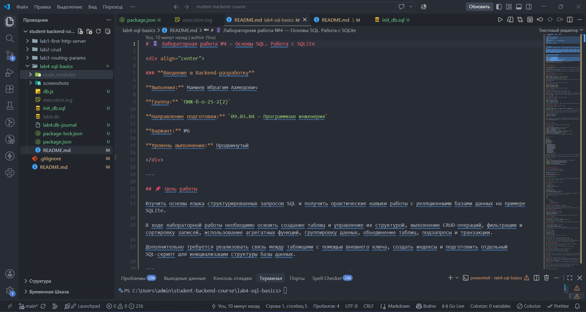

</details>

<details>
<summary>02. Создание базы данных</summary>

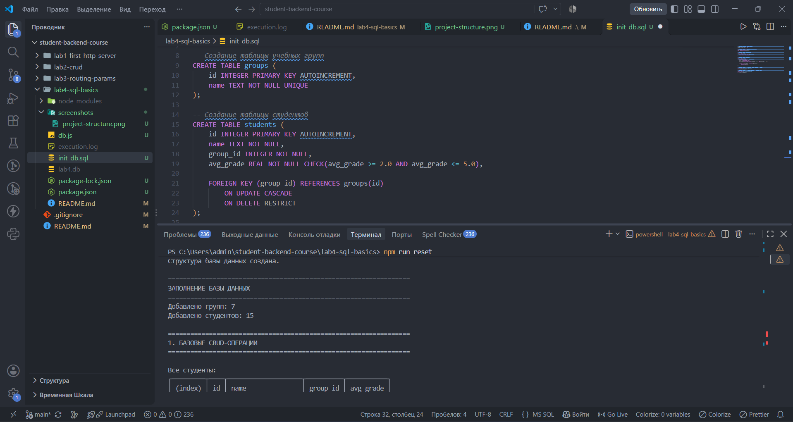

</details>

<details>
<summary>03. Добавление тестовых данных</summary>

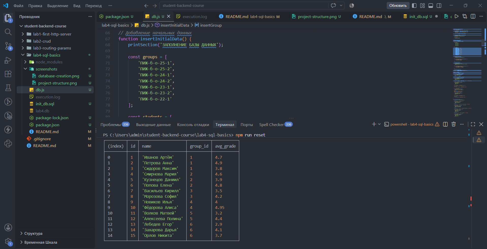

</details>

<details>
<summary>04. CRUD-операции</summary>

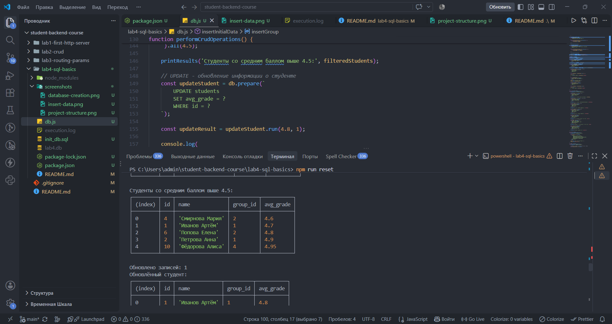

</details>

<details>
<summary>05. Сортировка и пагинация</summary>

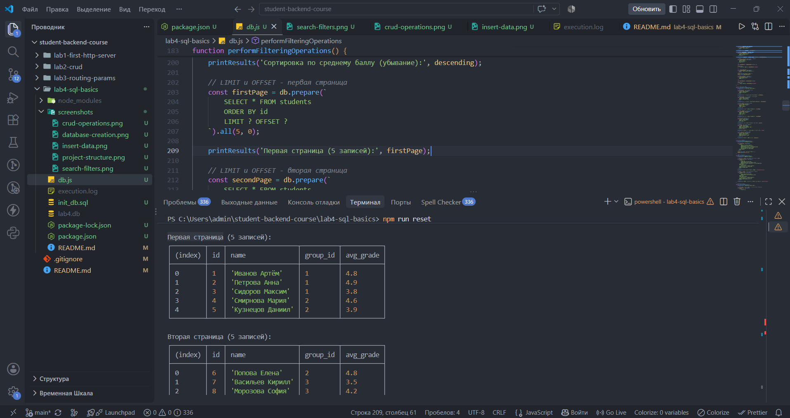

</details>

<details>
<summary>06. Поиск и фильтрация</summary>

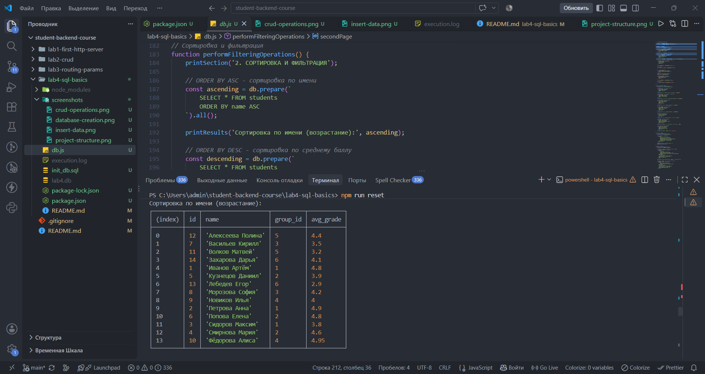

</details>

<details>
<summary>07. Агрегатные функции</summary>

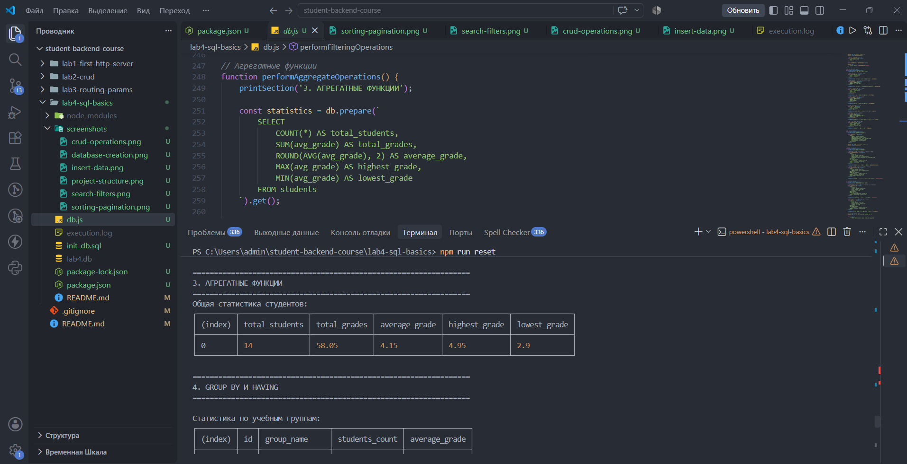

</details>

<details>
<summary>08. GROUP BY и HAVING</summary>

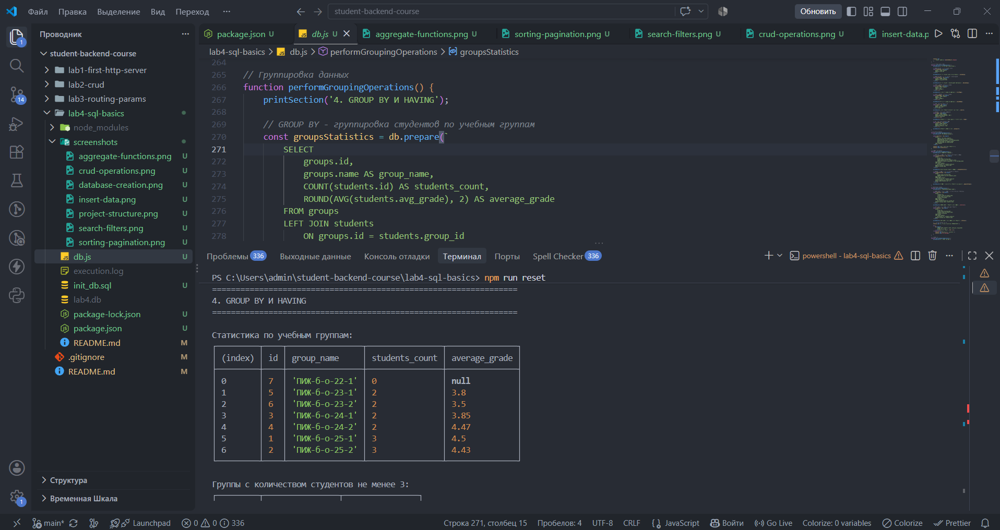

</details>

<details>
<summary>09. INNER JOIN</summary>

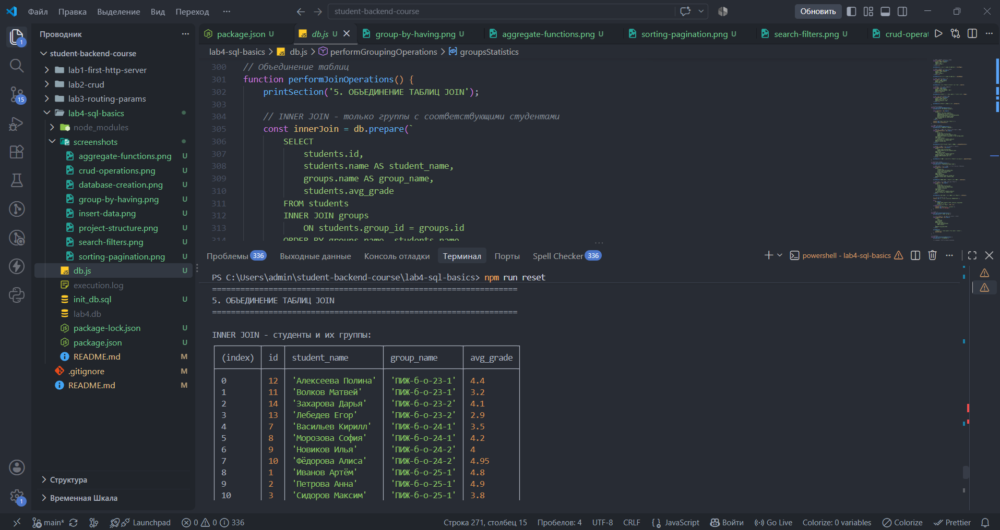

</details>

<details>
<summary>10. LEFT JOIN</summary>

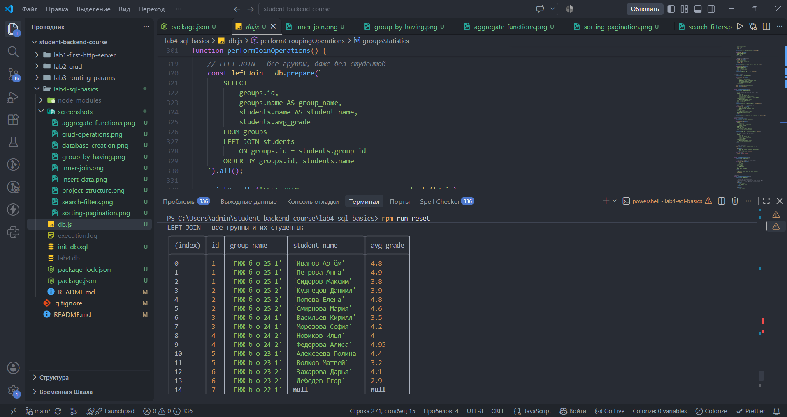

</details>

<details>
<summary>11. Подзапросы</summary>

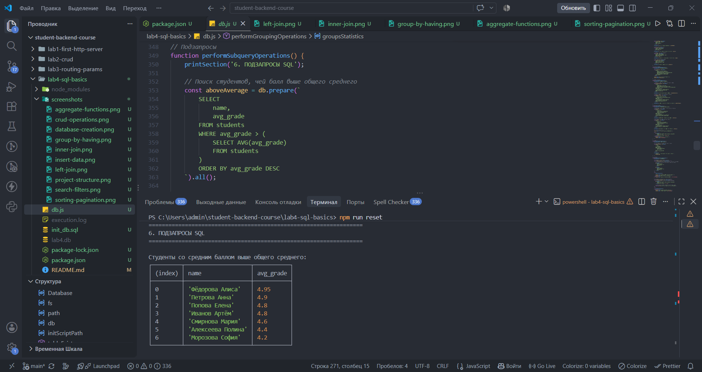

</details>

<details>
<summary>12. Транзакции</summary>

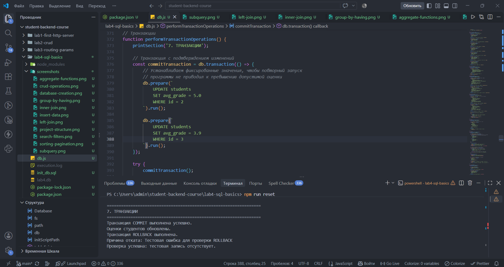

</details>

<details>
<summary>13. Внешние ключи</summary>

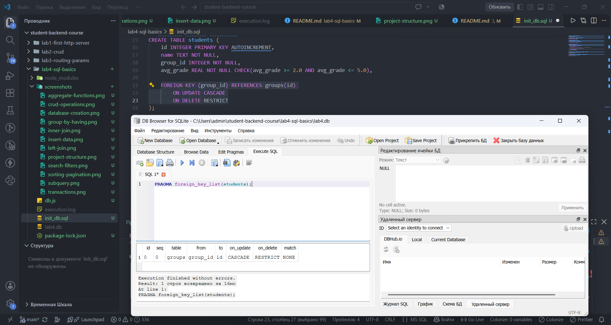

</details>

<details>
<summary>14. Индексы</summary>

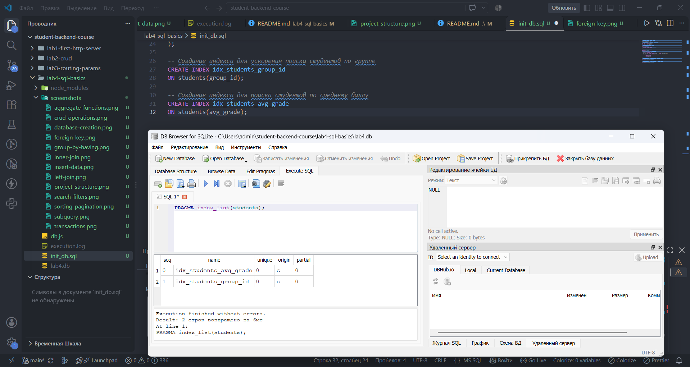

</details>

<details>
<summary>15. Структура базы данных</summary>

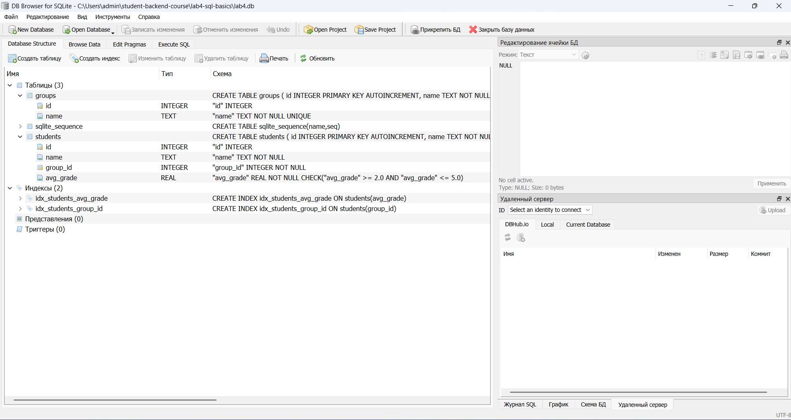

</details>

---

## ❓ Контрольные вопросы

### 1. Что такое SQL? Для чего он используется?

**SQL (Structured Query Language)** — язык структурированных запросов, предназначенный для работы с реляционными базами данных.

С его помощью можно создавать таблицы, добавлять, изменять и удалять записи, получать информацию, выполнять поиск, сортировку и группировку данных. SQL также позволяет управлять транзакциями и обеспечивать целостность базы данных.

### 2. Что такое SQLite? Чем он отличается от PostgreSQL/MySQL?

**SQLite** — компактная реляционная система управления базами данных, которая хранит всю базу в одном файле и не требует отдельного сервера.

Основные отличия:

- **SQLite** не требует установки и настройки отдельного сервера, подходит для небольших приложений, обучения и локального хранения данных.
- **PostgreSQL** — полноценная серверная СУБД с широкими возможностями, поддержкой сложных запросов, многопользовательской работы и масштабирования.
- **MySQL** — серверная реляционная СУБД, широко используемая в веб-приложениях и системах с большим количеством пользователей.

Главное преимущество SQLite — простота использования. Для выполнения лабораторной работы достаточно одного файла базы данных.

### 3. Какие основные типы данных в SQLite?

SQLite использует пять основных типов хранения данных:

| Тип | Описание | Пример |
|---|---|---|
| `INTEGER` | Целые числа | `25`, `100` |
| `REAL` | Числа с плавающей точкой | `4.5`, `3.14` |
| `TEXT` | Текстовые строки | `'Иванов'` |
| `BLOB` | Бинарные данные | Изображения, файлы |
| `NULL` | Отсутствие значения | `NULL` |

SQLite использует динамическую типизацию: тип хранения определяется самим значением, а не только объявленным типом столбца.

### 4. Как создать таблицу? Что такое PRIMARY KEY?

Для создания таблицы используется команда `CREATE TABLE`.

Пример:

```sql
CREATE TABLE students (
    id INTEGER PRIMARY KEY AUTOINCREMENT,
    name TEXT NOT NULL,
    avg_grade REAL
);
```

**PRIMARY KEY** — первичный ключ, который однозначно идентифицирует каждую запись таблицы.

Значения первичного ключа не должны повторяться. В SQLite первичный ключ часто создаётся на основе целочисленного поля `INTEGER PRIMARY KEY`.

### 5. Как вставить данные? Что делает INSERT?

Команда `INSERT` используется для добавления новых записей в таблицу.

Пример:

```sql
INSERT INTO students (name, avg_grade)
VALUES ('Иванов Артём', 4.7);
```

Также можно добавить несколько записей одним запросом:

```sql
INSERT INTO students (name, avg_grade)
VALUES
    ('Петрова Анна', 4.9),
    ('Сидоров Максим', 3.8);
```

После выполнения запроса новые записи сохраняются в таблице.

### 6. Как выбрать все данные из таблицы?

Для получения данных используется команда `SELECT`.

Чтобы получить все столбцы и записи таблицы, применяется символ `*`:

```sql
SELECT * FROM students;
```

Если необходимо получить только определённые столбцы, их можно перечислить:

```sql
SELECT name, avg_grade
FROM students;
```

### 7. Как выбрать данные с условием? Что такое WHERE?

`WHERE` — оператор, который позволяет отбирать записи по заданному условию.

Например, чтобы получить студентов со средним баллом выше 4.0:

```sql
SELECT *
FROM students
WHERE avg_grade > 4.0;
```

В условиях также можно использовать операторы сравнения, логические операторы `AND`, `OR`, `NOT` и другие условия.

### 8. Как обновить данные? Что делает UPDATE?

Команда `UPDATE` используется для изменения существующих записей в таблице.

Пример:

```sql
UPDATE students
SET avg_grade = 4.8
WHERE id = 1;
```

В данном случае средний балл студента с идентификатором 1 изменяется на 4.8.

Условие `WHERE` необходимо использовать, чтобы случайно не изменить все записи таблицы.

### 9. Как удалить данные? Что делает DELETE?

Команда `DELETE` используется для удаления записей из таблицы.

Пример:

```sql
DELETE FROM students
WHERE id = 1;
```

Данный запрос удаляет студента с идентификатором 1.

Если не указать `WHERE`, будут удалены все записи таблицы, поэтому при использовании `DELETE` необходимо внимательно проверять условие.

### 10. Что такое AUTOINCREMENT?

`AUTOINCREMENT` — ключевое слово SQLite, которое используется вместе с `INTEGER PRIMARY KEY` для автоматического увеличения значения первичного ключа.

Пример:

```sql
CREATE TABLE students (
    id INTEGER PRIMARY KEY AUTOINCREMENT,
    name TEXT NOT NULL
);
```

При добавлении новой записи SQLite автоматически назначает ей идентификатор.

В отличие от обычного `INTEGER PRIMARY KEY`, `AUTOINCREMENT` не позволяет повторно использовать ранее выданные идентификаторы удалённых записей. При этом он создаёт дополнительные накладные расходы, поэтому применяется только при необходимости.

### 11. Как отсортировать данные? Что делает ORDER BY?

`ORDER BY` используется для сортировки результатов запроса по одному или нескольким столбцам.

Существует два основных направления сортировки:

- `ASC` — по возрастанию;
- `DESC` — по убыванию.

Пример сортировки студентов по имени:

```sql
SELECT *
FROM students
ORDER BY name ASC;
```

Пример сортировки по среднему баллу:

```sql
SELECT *
FROM students
ORDER BY avg_grade DESC;
```

### 12. Как ограничить количество строк? Что такое LIMIT и OFFSET?

`LIMIT` задаёт максимальное количество записей, возвращаемых запросом.

`OFFSET` определяет количество записей, которые необходимо пропустить перед началом выборки.

Пример:

```sql
SELECT *
FROM students
LIMIT 5 OFFSET 5;
```

Запрос пропускает первые пять записей и возвращает следующие пять.

Эти операторы используются совместно для реализации пагинации.

### 13. Как реализовать поиск по подстроке? Что такое LIKE?

`LIKE` используется для поиска текстовых значений по определённому шаблону.

При поиске применяются специальные символы:

- `%` — любое количество символов;
- `_` — один произвольный символ.

Пример:

```sql
SELECT *
FROM students
WHERE name LIKE '%ова%';
```

Запрос возвращает студентов, в имени которых встречается последовательность символов «ова».

### 14. Как выбрать данные в диапазоне? Что такое BETWEEN?

`BETWEEN` используется для выборки значений, находящихся в заданном диапазоне. Границы диапазона включаются в результат.

Пример:

```sql
SELECT *
FROM students
WHERE avg_grade BETWEEN 4.0 AND 4.8;
```

Запрос возвращает студентов со средним баллом от 4.0 до 4.8 включительно.

### 15. Как выбрать данные из списка? Что такое IN?

`IN` позволяет проверить, входит ли значение поля в указанный список значений.

Пример:

```sql
SELECT *
FROM students
WHERE group_id IN (1, 2);
```

Запрос возвращает студентов, относящихся к первой или второй учебной группе.

Оператор `IN` удобен, когда необходимо проверить несколько возможных значений одного поля.

### 16. Какие агрегатные функции вы знаете?

Агрегатные функции выполняют вычисления над набором записей и возвращают одно итоговое значение.

Основные функции:

| Функция | Назначение |
|---|---|
| `COUNT()` | Подсчёт количества записей |
| `SUM()` | Вычисление суммы |
| `AVG()` | Вычисление среднего значения |
| `MAX()` | Поиск максимального значения |
| `MIN()` | Поиск минимального значения |

Пример:

```sql
SELECT
    COUNT(*) AS student_count,
    AVG(avg_grade) AS average_grade,
    MAX(avg_grade) AS max_grade,
    MIN(avg_grade) AS min_grade
FROM students;
```

В лабораторной работе эти функции используются для анализа количества студентов и их успеваемости.

### 17. Что такое GROUP BY? Для чего используется?

`GROUP BY` используется для объединения записей в группы по значениям одного или нескольких столбцов.

Обычно применяется совместно с агрегатными функциями.

Пример:

```sql
SELECT
    group_id,
    COUNT(*) AS student_count,
    AVG(avg_grade) AS average_grade
FROM students
GROUP BY group_id;
```

Запрос группирует студентов по учебным группам и рассчитывает количество студентов и их средний балл для каждой группы.

### 18. Чем отличается WHERE от HAVING?

`WHERE` и `HAVING` используются для фильтрации данных, но работают на разных этапах выполнения запроса.

- `WHERE` отбирает отдельные записи до группировки.
- `HAVING` фильтрует уже сформированные группы, в том числе по результатам агрегатных функций.

Пример:

```sql
SELECT
    group_id,
    COUNT(*) AS student_count
FROM students
WHERE avg_grade >= 3.0
GROUP BY group_id
HAVING COUNT(*) >= 3;
```

Сначала `WHERE` исключает студентов со средним баллом ниже 3.0, затем `GROUP BY` формирует группы, а `HAVING` оставляет только группы, в которых не менее трёх студентов.

### 19. Как реализовать пагинацию через SQL?

Пагинация — разделение большого набора данных на отдельные страницы с ограниченным количеством записей.

В SQL она реализуется с помощью `LIMIT` и `OFFSET`.

Пример получения второй страницы при размере страницы пять записей:

```sql
SELECT *
FROM students
ORDER BY id
LIMIT 5 OFFSET 5;
```

Для третьей страницы:

```sql
SELECT *
FROM students
ORDER BY id
LIMIT 5 OFFSET 10;
```

Значение `OFFSET` рассчитывается по формуле:

```text
OFFSET = (номер_страницы - 1) * размер_страницы
```

Сортировка по стабильному полю, например `id`, помогает избежать непредсказуемого порядка записей между страницами.

### 20. Как избежать SQL-инъекций? Что такое параметризованные запросы?

**SQL-инъекция** — уязвимость, при которой злоумышленник может изменить смысл SQL-запроса, передав специально сформированные данные.

Для защиты используются параметризованные запросы. В них значения передаются отдельно от SQL-команды, поэтому пользовательский ввод не интерпретируется как часть SQL-кода.

Пример с использованием `better-sqlite3`:

```js
const statement = db.prepare(`
    SELECT *
    FROM students
    WHERE id = ?
`);

const student = statement.get(1);
```

Вместо `?` библиотека безопасно подставляет переданное значение.

В лабораторной работе используется именно такой подход при выполнении запросов с динамическими значениями.

### 21. Что такое FOREIGN KEY? Зачем нужен?

**FOREIGN KEY** — внешний ключ, который устанавливает связь между таблицами и обеспечивает ссылочную целостность данных.

Он ссылается на первичный или уникальный ключ другой таблицы.

Пример:

```sql
CREATE TABLE groups (
    id INTEGER PRIMARY KEY,
    name TEXT NOT NULL
);

CREATE TABLE students (
    id INTEGER PRIMARY KEY,
    name TEXT NOT NULL,
    group_id INTEGER,
    FOREIGN KEY (group_id) REFERENCES groups(id)
);
```

В данной структуре `students.group_id` ссылается на `groups.id`.

В лабораторной работе внешний ключ не позволяет добавить студента в несуществующую учебную группу.

Для SQLite проверка внешних ключей должна быть включена с помощью:

```sql
PRAGMA foreign_keys = ON;
```

### 22. Что такое JOIN? Какие виды JOIN вы знаете?

`JOIN` — оператор SQL, предназначенный для объединения данных из нескольких таблиц на основании заданного условия.

Основные виды:

- **INNER JOIN** — возвращает только записи, имеющие совпадения в обеих таблицах.
- **LEFT JOIN** — возвращает все записи левой таблицы и соответствующие записи правой таблицы.
- **RIGHT JOIN** — возвращает все записи правой таблицы и совпадающие записи левой таблицы.
- **FULL OUTER JOIN** — возвращает все записи обеих таблиц, включая несовпадающие.

В лабораторной работе используются `INNER JOIN` и `LEFT JOIN` для объединения информации о студентах и учебных группах.

### 23. Чем отличается INNER JOIN от LEFT JOIN?

Основное отличие заключается в том, какие записи попадают в результат.

**INNER JOIN** возвращает только те записи, для которых найдено соответствие в обеих таблицах.

**LEFT JOIN** возвращает все записи левой таблицы, даже если соответствующих записей в правой таблице нет. В таком случае поля правой таблицы будут содержать `NULL`.

Пример:

```sql
SELECT
    groups.name,
    students.name AS student_name
FROM groups
INNER JOIN students
    ON groups.id = students.group_id;
```

Этот запрос покажет только группы, в которых есть студенты.

Если заменить `INNER JOIN` на `LEFT JOIN`, в результат попадут также пустые группы.

### 24. Что такое подзапрос? Приведите пример.

**Подзапрос** — SQL-запрос, вложенный внутрь другого запроса.

Он позволяет использовать результат одного запроса при выполнении другого.

Пример:

```sql
SELECT *
FROM students
WHERE avg_grade > (
    SELECT AVG(avg_grade)
    FROM students
);
```

Внутренний запрос вычисляет общий средний балл всех студентов.

Внешний запрос выбирает только тех студентов, чей средний балл выше полученного значения.

### 25. Что такое транзакция? Что делают BEGIN, COMMIT, ROLLBACK?

**Транзакция** — последовательность операций с базой данных, которая выполняется как единое целое.

Она помогает сохранять согласованность данных и предотвращает частичное применение изменений при возникновении ошибок.

Основные команды:

- `BEGIN` — начало транзакции;
- `COMMIT` — подтверждение изменений и их сохранение;
- `ROLLBACK` — отмена изменений, выполненных в рамках транзакции.

Пример:

```sql
BEGIN TRANSACTION;

UPDATE students
SET avg_grade = 4.8
WHERE id = 1;

COMMIT;
```

Если во время выполнения транзакции возникла ошибка, можно выполнить:

```sql
ROLLBACK;
```

В лабораторной работе механизм транзакций демонстрируется с помощью `COMMIT` для сохранения изменений и `ROLLBACK` для отмены временной записи.

### 26. Что такое индекс? Зачем нужен? Как создать?

**Индекс** — дополнительная структура базы данных, которая ускоряет поиск и выборку записей по определённым столбцам.

Без подходящего индекса СУБД может выполнять полный просмотр таблицы. Индекс позволяет быстрее находить необходимые записи.

Создание индекса:

```sql
CREATE INDEX idx_students_group_id
ON students(group_id);
```

Создание индекса по среднему баллу:

```sql
CREATE INDEX idx_students_avg_grade
ON students(avg_grade);
```

Индексы ускоряют некоторые операции чтения, однако занимают дополнительное место и могут замедлять добавление, изменение и удаление записей, поскольку их структуру также необходимо обновлять.

### 27. Как организовать миграции БД?

**Миграции базы данных** — способ управления изменениями структуры базы данных с помощью отдельных SQL-скриптов.

Миграции позволяют последовательно создавать таблицы, добавлять новые столбцы, изменять ограничения, создавать индексы и выполнять другие изменения структуры.

В крупных проектах обычно используются отдельные файлы миграций с номерами или версиями, например:

```text
migrations/
    001_create_groups.sql
    002_create_students.sql
    003_add_indexes.sql
```

Такая организация позволяет отслеживать, какие изменения уже были применены к базе данных.

В данной лабораторной работе используется упрощённый вариант: отдельный файл `init_db.sql`, содержащий команды создания таблиц, внешних ключей и индексов. Он выполняется из `db.js` при первоначальной инициализации или полном сбросе базы данных.

### 28. Что такое нормализация? Какие нормальные формы вы знаете?

**Нормализация** — процесс организации данных в реляционной базе данных, направленный на уменьшение дублирования информации и предотвращение проблем при добавлении, изменении и удалении записей.

Основные нормальные формы:

- **Первая нормальная форма (1NF):** каждое поле содержит одно неделимое значение, отсутствуют повторяющиеся группы данных.
- **Вторая нормальная форма (2NF):** таблица находится в первой нормальной форме, а каждый неключевой атрибут зависит от всего первичного ключа, а не от его части.
- **Третья нормальная форма (3NF):** таблица находится во второй нормальной форме, а неключевые атрибуты не зависят транзитивно от первичного ключа.

В лабораторной работе нормализация проявляется в разделении информации о студентах и учебных группах на две связанные таблицы. Название группы хранится отдельно, а в таблице студентов используется только `group_id`. Это позволяет избежать многократного повторения названий групп.

### 29. Как оптимизировать SQL-запросы?

Оптимизация SQL-запросов направлена на уменьшение времени выполнения операций и нагрузки на базу данных.

Основные способы оптимизации:

1. Создавать индексы для столбцов, которые часто используются в условиях `WHERE`, соединениях и сортировке.
2. Не использовать `SELECT *`, если необходимы только отдельные столбцы.
3. Применять фильтрацию с помощью `WHERE`, чтобы получать только нужные записи.
4. Использовать подходящие условия соединения таблиц.
5. Ограничивать количество возвращаемых записей через `LIMIT`.
6. Избегать лишних подзапросов и повторных вычислений.
7. Анализировать план выполнения запросов с помощью инструментов SQLite.

При этом индексы следует создавать обоснованно, поскольку большое количество индексов увеличивает затраты на изменение данных.

### 30. Что такое EXPLAIN? Как использовать для анализа запросов?

`EXPLAIN` — команда SQLite, позволяющая посмотреть, как СУБД планирует выполнять SQL-запрос.

Для анализа запросов часто используется `EXPLAIN QUERY PLAN`. Она показывает основные этапы выполнения запроса, в том числе способы поиска записей и использование индексов.

Пример:

```sql
EXPLAIN QUERY PLAN
SELECT *
FROM students
WHERE group_id = 2;
```

В результате можно увидеть, выполняется ли полный просмотр таблицы или используется индекс.

В лабораторной работе данный инструмент применяется для проверки запроса по полю `group_id` и анализа использования созданного индекса `idx_students_group_id`.

---

## 📌 Вывод

В ходе лабораторной работы были изучены основы языка SQL и принципы взаимодействия приложения Node.js с реляционной базой данных SQLite.

Была создана база данных для учёта студентов и учебных групп, реализована связь между таблицами с использованием внешнего ключа, добавлены тестовые записи и выполнены основные CRUD-операции.

На практике были применены сортировка, фильтрация, пагинация, агрегатные функции, группировка данных, объединение таблиц с помощью INNER JOIN и LEFT JOIN, а также подзапросы.

Дополнительно были реализованы транзакции с использованием COMMIT и ROLLBACK, созданы индексы и подготовлен отдельный SQL-скрипт `init_db.sql` для инициализации структуры базы данных.

В результате выполнения лабораторной работы получены практические навыки проектирования реляционных баз данных, написания SQL-запросов и организации взаимодействия backend-приложения с SQLite.

---

## 📚 Использованные источники

1. [SQLite — официальная документация](https://www.sqlite.org/docs.html).
2. [SQLite Tutorial](https://www.sqlitetutorial.net/).
3. [SQLBolt — интерактивное изучение SQL](https://sqlbolt.com/).
4. [better-sqlite3 — документация npm-пакета](https://www.npmjs.com/package/better-sqlite3).
5. [DB Browser for SQLite — официальный сайт](https://sqlitebrowser.org/).
6. Методические указания к лабораторной работе №4 «Основы SQL. Работа с SQLite».

---

<div align="center">

### 💻 Backend Development

**Мамиев Ибрагим Ахмедович**

**ПИЖ-б-о-25-2(2)**

**Вариант №6 — Продвинутый уровень**

</div>